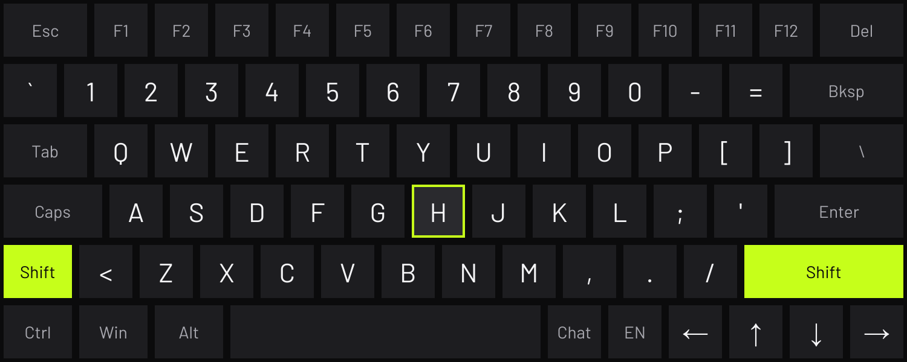

# DesktopVR: free, open-source desktop overlay for SteamVR

**Use your Windows desktop in VR without taking the headset off.** DesktopVR is a lightweight SteamVR overlay:
point at your screens and click, type on a two-hand VR keyboard, send messages to the VRChat chatbox, glance at
your wrist for time, batteries and load, then get back to the game.

It costs about **0.01 ms of GPU time per frame** and shows its own cost live. Everything stays out of your
way until you need it: hold one button to hide it all. No account, no telemetry, no paid tier.

[**Download for Windows**](https://github.com/EncidXVII/DesktopVR/releases/latest) ·
[Report a bug](https://github.com/EncidXVII/DesktopVR/issues/new/choose)

> **Status: early access (0.1).** The Windows build works end to end with SteamVR. Linux and Steam Frame
> (on-device) are in progress. Not yet tested on every headset: please send a self-test report (below).

## Features

- **Your desktop in VR**: every monitor as its own panel, flat or curved, at any size and distance.
  Mixed-DPI and multi-monitor setups map exactly.
- **Any window as its own panel**: pick it from the window list, or grip a screen and yank the window under
  the pointer out of it.
- **Panel toolbar**: point at a screen or window and a toolbar appears under it: lock, curve, smaller / bigger,
  opacity, anchor (world, hand, or head-locked HUD that follows your view), close.
- **Hide everything with one button**: hold the left menu button to fade all panels out (and back in). Hidden
  panels stop capturing, so they cost nothing.
- **Laser pointer that doesn't misclick**: trigger to click, hold for right click, drag, thumbstick to scroll.
  Hovering never clicks, and hand tremor is smoothed out without making fast aiming lag.
- **Two-hand VR keyboard** in your Windows layout, with a language key (EN, UK, DE, ... cycles your installed
  input languages), sticky Shift / Ctrl / Alt and typing sounds.
- **VRChat chatbox keyboard**: Chat mode sends what you type straight to the VRChat chatbox over OSC, plus
  "share now playing".
- **Wrist watch that stays out of the way**: just the time and batteries, shown only while you look at your
  wrist. Point at it for Menu, Keyboard, Hide all, media controls, fps / load and this overlay's own cost.
  Notifications pop up on it; the last few stay in Menu > Notifications.
- **Discord notifications on your wrist**: Discord messages (or, if you choose, any app's Windows notifications)
  pop up on the watch with a buzz, no Discord login or bot needed. Apps that send XSOverlay notifications
  (UDP 42069) work too.
- **Game input stays yours**: only the hand that points at or holds a panel is taken from the game; the
  other hand keeps playing.
- **Rebindable** in SteamVR's own binding UI. Default bindings for Valve Index, Meta Quest (Touch),
  HTC Vive, Windows Mixed Reality and Steam Frame controllers.

| Wrist (point at it to expand) | Panel toolbar |
|---|---|
|  |  |

## Install (3 steps)

1. Have [SteamVR](https://store.steampowered.com/app/250820/SteamVR/) installed.
2. [Download the latest release](https://github.com/EncidXVII/DesktopVR/releases/latest), unzip it and run
   `DesktopVR.exe`. There's no installer and nothing else to set up.
3. Put on your headset and follow the 4-step first run (hand, main screen, keyboard test, tips). It takes
   under a minute.

It starts with SteamVR from then on; untick **Start with SteamVR** in the tray icon to stop that.

## Switching from XSOverlay, OVR Toolkit or Desktop+

On first run DesktopVR reads your XSOverlay settings file (your own `overlaySettings.json`) and keeps your
pointing hand, typing sounds, curved screens and default opacity. Nothing in XSOverlay is changed.

| You did this before | Do this here |
|---|---|
| Open the overlay menu | Double-tap the left menu button, or point at your watch and press Menu |
| Toggle all overlays | Hold the left menu button |
| Add a window | Menu > Add window, or grip a screen and yank the window toward you |
| Window toolbar (opacity, size, close...) | Point at the window: the toolbar appears under it |
| Type into VRChat | Press **Chat** on the keyboard |
| Notifications from your apps | Apps using the XSOverlay notification API work unchanged |

Run one overlay at a time: two overlays fight over the same controller input and notification port.

## Controls

- **Trigger**: click. Hold ~0.6 s: right click. Hold and move: drag.
- **Thumbstick** on a screen: scroll. While holding a panel: push / pull.
- **Grip**: move a panel. Both hands: resize and turn. Locked panels ignore grip.
- **Point at a panel**: its toolbar appears underneath (lock, curve, size, opacity, World / Hand / Head, close).
- **Left menu button**: double-tap for the menu, hold to hide or show everything.
- **Watch**: look at your wrist to see it; point at it with the other hand for Menu, Keyboard and Hide all.
- **Keyboard**: use both hands at once. Shift / Ctrl / Alt light up and apply to the next key. The language
  key switches input language.
- **Menu**: Panels (add screen or window, recenter, hide all, notifications), Keyboard, Wrist (what the watch shows, which
  wrist), Settings (pointing hand, start with SteamVR, vibration, curved screens, updates, quit).

## Performance

Measured on the build machine (RTX 5070 Ti, Windows 11, SteamVR) with a constantly changing desktop, which is
the worst case (60 fps capture):

| Budget | Target | Measured |
|---|---|---|
| GPU per VR frame (this overlay) | < 0.3 ms | 0.005–0.02 ms |
| CPU, one core | < 3 % | 0.6–2.8 % |
| RAM | < 150 MB | 64–78 MB |

The same numbers are shown live in Settings and on the expanded watch, so you can check them on your own
machine.

## FAQ

**Is it free?** Yes. Free and open source under GPL-3.0, with no paid tier, account or ads.

**Which headsets work?** Anything that runs SteamVR: Valve Index, Meta Quest 2 / 3 / Pro (Link, Air Link,
Virtual Desktop or Steam Link), HTC Vive, Pico, Bigscreen Beyond, Windows Mixed Reality, Steam Frame.

**Does it work with VRChat?** Yes. It runs alongside VRChat, types into the chatbox via OSC (enable OSC in
VRChat's Action Menu), and takes only the hand you're pointing with away from the game.

**Does it work on Linux?** Not yet. Linux (Wayland screen capture, input) and Steam Frame on-device builds are
in progress; the Linux release builds and runs the self-test today.

**Does it slow down my game?** It's designed not to: about 0.01 ms GPU per frame and a few percent of one CPU
core. Hidden panels stop capturing entirely. Settings shows the real cost on your machine.

**Is Windows SmartScreen warning me?** Early builds aren't code-signed yet (see
[code signing policy](docs/code-signing-policy.md)). Every release ships a SHA-256 checksum.

## Self-test and bug reports

`DesktopVR.exe --selftest` runs the automatic checks on your machine and writes `selftest-report.zip` (results,
GPU model, monitor resolutions; no names, paths or identifiers). Attach it to a
[bug report](https://github.com/EncidXVII/DesktopVR/issues/new/choose).

## Privacy

No telemetry. Network use: a GitHub release check (no identifiers), VRChat OSC on localhost, the notification
API on localhost. Nothing else. Windows notifications (Discord by default) are read on your PC only to show them
on the watch; they are never stored on disk or sent anywhere. Switch it off in Menu > Notifications.

## Building from source

Rust stable (1.85+). `cargo test --workspace`, `cargo run -p dvr-app -- --selftest`. Live checks against
SteamVR's null driver: `harness/null-driver.ps1 target/release/dvr-app.exe --selftest --vr` (backs up and
restores your SteamVR settings). See [CONTRIBUTING.md](CONTRIBUTING.md).

## License

[GPL-3.0-or-later](LICENSE). Third-party licenses: [THIRD_PARTY_NOTICES.md](THIRD_PARTY_NOTICES.md).
DesktopVR is not affiliated with Valve, VRChat, XSOverlay, OVR Toolkit or Desktop+; names are used only to
describe compatibility.
