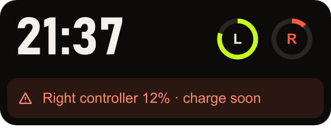
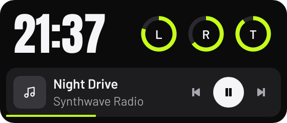

<picture>
  <source media="(prefers-color-scheme: dark)" srcset="packaging/brand/wristxr-mark.svg">
  
</picture>

# WristXR: free VR desktop overlay with wrist clock for SteamVR

**Use your desktop in VR without taking the headset off.** WristXR is a free, open-source SteamVR desktop overlay
for Windows and Linux:
point at your screens and click, type on a two-hand VR keyboard, send messages to the VRChat chatbox, glance at
your wrist for time, batteries and load, then get back to the game.

It costs under **0.1 ms of GPU time per frame** and shows its own cost live. Everything stays out of your
way until you need it: hold one button to hide it all. No account, no telemetry, no paid tier.

[**Download for Windows and Linux**](https://github.com/EncidXVII/WristXR/releases/latest) ·
[Report a bug](https://github.com/EncidXVII/WristXR/issues/new/choose)

> **Status: early access (0.1).** The Windows build works end to end with SteamVR. The Linux build (X11 and
> Wayland) is new and not yet tested on hardware, and not every headset has been tried. Linux testers and headset
> self-test reports are what it needs most: see [Status and help wanted](#status-and-help-wanted).

## At a glance

| | |
|---|---|
| **What it is** | A SteamVR overlay that puts your desktop screens and windows in VR, with a wrist watch for the time, controller batteries, music, messages and frame rate |
| **Use it for** | Using the desktop without taking the headset off, typing into VRChat, reading Discord messages in VR, checking battery and fps at a glance |
| **Platforms** | Windows 10 and 11; Linux on X11 and Wayland (new, not yet tested on hardware) |
| **Headsets** | Anything on SteamVR: Valve Index, Meta Quest 2 / 3 / Pro (Link, Air Link, Virtual Desktop, Steam Link), HTC Vive, Pico, Bigscreen Beyond, Windows Mixed Reality, Steam Frame |
| **Cost in a game** | Under 0.1 ms of GPU time per frame, shown live |
| **Price** | Free. No account, no telemetry, no paid tier |
| **Status** | Early access (0.1): Windows works end to end; Linux is new and needs testers; English only so far |
| **Comes from** | XSOverlay, OVR Toolkit and Desktop+ users can switch in a minute: settings import and the same notification API |
| **License** | Open source, `GPL-3.0-or-later`, © 2026 EncidXVII |

## Features

- **Your desktop in VR**: every monitor as its own panel, flat or curved, at any size and distance.
  Mixed-DPI and multi-monitor setups map exactly.
- **Any window as its own panel**: pick it from the window list, or grip a screen and yank the window under
  the pointer out of it.
- **Panel toolbar**: point at a screen or window and a toolbar appears under it, starting with the panel's name:
  lock, curve, free angle, size, an opacity slider, Room / Hand / Head (a head-locked HUD that follows your
  view), reset, close.
- **Hide everything with one button**: double-tap the left menu button, like XSOverlay, to fade screens, windows
  and keyboard out; again, and they come back as arranged in front of where you face now. Hidden
  panels stop capturing, so they cost nothing.
- **Laser pointer that doesn't misclick**: trigger to click, A / X (or hold the trigger) for right click, drag,
  thumbstick to scroll.
  Hovering never clicks, and hand tremor is smoothed out without making fast aiming lag.
- **Two-hand VR keyboard** in your Windows layout, with a language key (EN, UK, DE, ... cycles your installed
  input languages), sticky Shift / Ctrl / Alt and typing sounds.
- **VRChat chatbox keyboard**: Chat mode sends what you type straight to the VRChat chatbox over OSC, plus
  "share now playing".
- **Wrist watch that stays out of the way**: the time, date and battery rings, shown only while you look at your
  wrist, plus one line for what is playing (with a pause button), a new message or a low battery. Point at the
  time to open it: seek bar, play / skip / shuffle, share the song to VRChat, Windows volume and mute, switches
  for Show overlay and Keyboard, Add (a window or the next screen, right there on the watch), the Inbox, the menu,
  and fps / load / this overlay's own cost.
- **Seven watch layouts** for the glance: Standard, Clock, No batteries, Batteries, Music (a small player with
  back / play / next), Performance (fps, CPU and GPU) and Compact (one slim bar). Messages and low batteries come
  through in every one, and opening the watch looks the same in all of them.
- **Themes**: eight accent colours (Lime, Mint, Aqua, Sky, Violet, Pink, Amber, White) in Setup > Theme.
- **Discord notifications on your wrist**: Discord messages (or, if you choose, any app's Windows notifications)
  pop up with a buzz as a banner low in your view (who, the app, and up to three lines of the message; point at
  it to keep it) and on the watch, no Discord login or bot needed; the last few wait in the menu's Inbox. Apps that send XSOverlay notifications
  (UDP 42069) work too.
- **Game input stays yours**: a hand on a panel takes from the game only the controls that do something there
  (the stick only over a screen or window), and only once you let them go; the other hand keeps playing.
- **Rebindable** in SteamVR's own binding UI. Default bindings for Valve Index, Meta Quest (Touch),
  HTC Vive, Windows Mixed Reality and Steam Frame controllers.

| Watch at a glance | Watch, pointed at |
|---|---|
|    |  |

| Music layout | Performance layout | Compact layout |
|---|---|---|
|  |  |  |

## Install (3 steps)

1. Have [SteamVR](https://store.steampowered.com/app/250820/SteamVR/) installed.
2. [Download the latest release](https://github.com/EncidXVII/WristXR/releases/latest), unzip it and run
   `WristXR.exe`. There's no installer and nothing else to set up.
3. Put on your headset and follow the 4-step first run (hand, main screen, keyboard test, tips). It takes
   under a minute.

It starts with SteamVR from then on; untick **Start with SteamVR** in the tray icon to stop that.

**Uninstall:** quit WristXR (tray icon > Quit), run `Uninstall WristXR.cmd` in its folder (or
`WristXR.exe --uninstall`) and confirm. That takes it off SteamVR's list and deletes its settings and layout;
then delete the folder.

### Linux

Unpack the Linux archive, run `./install.sh`, start SteamVR, then run `~/.local/share/wristxr/wristxr`. It
registers with SteamVR and starts with it from then on. `./uninstall.sh` undoes it all.

- **Wayland** (GNOME, KDE Plasma, and others with a desktop portal): the first run asks once, on the desktop, which
  screens and windows to share and whether WristXR may use the keyboard and pointer. Take the headset off to
  answer; later runs remember it. Windows show as "Shared window 1, 2..." (Wayland gives no titles), and a window
  cannot be pulled out of a screen.
- **X11**: everything works as on Windows, with no prompt.
- Needs Vulkan, fontconfig and, on Wayland, PipeWire and xdg-desktop-portal (all standard on current desktops).
  The tray icon needs a StatusNotifierItem tray (KDE, XFCE, GNOME with the AppIndicator extension).
- Not on Linux yet: the screen detail pass (on Linux SteamVR shrinks screens itself), key click sounds, switching the keyboard language from VR (the
  keys type in your system layout; their labels show US), and the GPU load on NVIDIA.

## Switching from XSOverlay, OVR Toolkit or Desktop+

On first run WristXR reads your XSOverlay settings file (your own `overlaySettings.json`) and keeps your
pointing hand, typing sounds, curved screens and default opacity. Nothing in XSOverlay is changed.

| You did this before | Do this here |
|---|---|
| Open the overlay menu | Point at your watch and press Menu (or the tray icon) |
| Toggle all overlays | Double-tap the left menu button, same as XSOverlay |
| Add a window | Menu > Add window, or grip a screen and yank the window toward you |
| Window toolbar (opacity, size, close...) | Point at the window: the toolbar appears under it |
| Type into VRChat | Press **Chat** on the keyboard |
| Notifications from your apps | Apps using the XSOverlay notification API work unchanged |

Run one overlay at a time: two overlays fight over the same controller input and notification port.

## Controls

- **Trigger**: click. Hold and move: drag. Hold still ~0.6 s (a tick) and let go: right click; move instead and
  it is still a drag (Setup > Controls can turn the right click off).
- **A or X** (the lower half of the trackpad on Vive and WMR wands): right click where you point; hold and move
  to right-drag.
- **Thumbstick** on a screen: scroll. Or turn on **Drag to scroll** (Setup > Controls) and pull the page with the
  trigger, like a touchscreen (handy on wands without a stick; drag-to-select text is off while it is on).
- **Grip**: grab a panel. The spot you grabbed stays under the laser and the panel stays level, turned to face
  you, so a twist of the wrist never tips it (unless the toolbar's free angle is on: then it turns with your hand
  and stays at the angle you leave it). While holding: stick up / down pushes and pulls, stick left / right
  resizes. Both grips: resize by moving your hands apart. Locked panels ignore grip.
- **Put a panel on a hand**: hold it, bring it to your other hand and let go: it sits above that hand like a
  tablet and moves with it. Grab it away and let go in the room to put it back. The toolbar's Hand does the same
  for the hand you are not pointing with.
- **Move the watch**: grip it with your other hand and slide it along your wrist, turning that hand to tilt it; it
  stays on that wrist and keeps its spot and tilt. Menu > Reset layout puts it back.
- **Toolbar size**: - and + step through round sizes (1.0, 1.2, 1.5, 2.0 m...) and ease there.
- **Setup > Controls** lists all of this in VR; Rebind buttons there opens SteamVR's binding screen for
  WristXR, where every action can go on another button.
- **Point at a panel**: its toolbar appears underneath (name, lock, curve, free angle, size, opacity, Room / Hand /
  Head, reset, close). The keyboard's toolbar has your input languages and Put away.
- **Left menu button**: double-tap to hide screens, windows and keyboard; again to bring them back, as arranged,
  in front of where you face now (handy after a playspace mover).
- **Toolbar Reset** puts a panel back in front of you; **Menu > Reset layout** arranges all screens and windows
  in an arc in front of you.
- **Watch**: look at your wrist to see it; its pause button works as is. Point at the time with the other hand
  to open the player, volume and quick switches. It grows downward, so nothing moves under your laser. Add >
  Window lists your windows on the watch; pick one and it opens in front of you. Menu > Watch > Layout picks
  what the glance shows.
- **Keyboard**: use both hands at once. Shift / Ctrl / Alt light up and apply to the next key. The language
  key switches input language.
- **Menu** (side rail): Panels (add a window or screen, recenter, reset layout, Overlay / Keyboard switches, and
  everything open now with a close button), Keys (language, chat, key sounds, share songs), Watch (layout and
  what it shows), Inbox (recent messages; Discord / All apps / Off), Setup (laser hand, watch hand, vibration,
  steady laser, start with SteamVR, updates, curved screens, theme, quit).

| Panels | Setup |
|---|---|
|  |  |
|  |  |

## Performance

Measured on the build machine (RTX 5070 Ti, Windows 11, SteamVR) with a constantly changing desktop, which is
the worst case (60 fps capture):

| Budget | Target | Measured |
|---|---|---|
| GPU per VR frame (this overlay) | < 0.3 ms | 0.01–0.1 ms |
| CPU, one core | < 3 % | 0.6–2.8 % |
| RAM | < 150 MB | 64–78 MB |

The same numbers are shown live in Setup and on the open watch, so you can check them on your own
machine.

## Status and help wanted

WristXR is in early access (0.1). Where each part stands, and what moves it forward:

| Area | Where it stands | What helps |
|---|---|---|
| **Windows** | Works end to end with SteamVR. This is the build it is developed and measured on | A [bug report](https://github.com/EncidXVII/WristXR/issues/new/choose) with `selftest-report.zip` when something is off |
| **Linux (X11 and Wayland)** | New: written and compiled, not yet run on a Linux machine with a headset. Still missing there: the screen detail pass, key click sounds, switching the keyboard language from VR, GPU load on NVIDIA | Test reports from KDE Plasma, GNOME and other desktops, on X11 and on Wayland, with NVIDIA and AMD cards; fixes for what breaks |
| **Headsets and controllers** | Default bindings for Valve Index, Meta Quest (Touch), HTC Vive, Windows Mixed Reality and Steam Frame controllers. Not every one has been tried on the real device | A self-test report from your headset, even when everything worked: say which headset, controllers and streaming method |
| **Steam Frame** | Bindings and the Linux build are written for it; no reports yet | The "Steam Frame test report" issue template |
| **Languages** | English only. Every string is in one file, `crates/ui/locales/en-US.ftl`; loading other languages is the next step | Open an issue to claim a language |
| **Code signing** | Builds are not signed yet, so Windows SmartScreen warns on first run | Nothing: see the [code signing policy](docs/code-signing-policy.md) |

How to send any of these: [CONTRIBUTING.md](CONTRIBUTING.md).

## FAQ

**Is it free?** Yes. Free and open source under GPL-3.0, with no paid tier, account or ads.

**Which headsets work?** Anything that runs SteamVR: Valve Index, Meta Quest 2 / 3 / Pro (Link, Air Link,
Virtual Desktop or Steam Link), HTC Vive, Pico, Bigscreen Beyond, Windows Mixed Reality, Steam Frame.

**Does it work with VRChat?** Yes. It runs alongside VRChat, types into the chatbox via OSC (enable OSC in
VRChat's Action Menu), and takes from the game only the controls you're using on a panel.

**Does it work on Linux?** Yes, on X11 and Wayland with SteamVR for Linux (see [Linux](#linux)). It is new and not
yet tested on hardware, so please report what you find.

**Does it slow down my game?** It's designed not to: under 0.1 ms GPU per frame and a few percent of one CPU
core. Hidden panels stop capturing entirely. Setup shows the real cost on your machine.

**Is Windows SmartScreen warning me?** Early builds aren't code-signed yet (see
[code signing policy](docs/code-signing-policy.md)). Every release ships a SHA-256 checksum.

## Self-test and bug reports

`WristXR.exe --selftest` runs the automatic checks on your machine and writes `selftest-report.zip` (results,
GPU model, monitor resolutions; no names, paths or identifiers). Attach it to a
[bug report](https://github.com/EncidXVII/WristXR/issues/new/choose).

## Privacy

No telemetry. Network use: a GitHub release check (no identifiers), VRChat OSC on localhost, the notification
API on localhost. Nothing else. Windows notifications (Discord by default) are read on your PC only to show them
on the watch; they are never stored on disk or sent anywhere. Switch it off in Menu > Inbox (Off).

## Building from source

Rust stable (1.85+). `cargo test --workspace`, `cargo run -p wxr-app -- --selftest`. Linux needs
`libfontconfig1-dev pkg-config`; Vulkan and PipeWire are loaded at run time, so their headers are not needed. Live checks against
SteamVR's null driver: `harness/null-driver.ps1 target/release/wxr-app.exe --selftest --vr` (backs up and
restores your SteamVR settings). See [CONTRIBUTING.md](CONTRIBUTING.md).

## More PC VR tools from the same author

Four free, open-source tools for PC VR by [EncidXVII](https://github.com/EncidXVII), with one look and one way of working:

| | |
|---|---|
| **WristXR (this one)** | VR desktop overlay with wrist clock |
| **[PortXR](https://github.com/EncidXVII/PortXR)** | Play flat PC games in VR |
| **[FoveaXR](https://github.com/EncidXVII/FoveaXR)** | Foveated rendering for any PC VR game |
| **[SweatXR](https://github.com/EncidXVII/SweatXR)** | VR fitness and calorie tracker |

## License and credit

Copyright © 2026 [EncidXVII](https://github.com/EncidXVII). WristXR is free software under the [GNU General Public License, version 3 or later](LICENSE)
(`GPL-3.0-or-later`), with the attribution and naming terms in [NOTICE](NOTICE).

- **You may** use it for anything, read the code, change it and share it.
- **If you share it, or anything built from its code,** you must publish your source under the same license, keep
  the copyright lines and the NOTICE file, and say clearly that yours is a changed version.
- **You may not** put its code in a closed-source product, remove the credit, or call a changed version "WristXR" or
  use its logo: see [TRADEMARKS.md](TRADEMARKS.md).

Third-party components and their licenses: [THIRD_PARTY_NOTICES.md](THIRD_PARTY_NOTICES.md). To cite WristXR:
[CITATION.cff](CITATION.cff).

WristXR is not affiliated with Valve, VRChat, XSOverlay, OVR Toolkit or Desktop+; names are used only to
describe compatibility.
